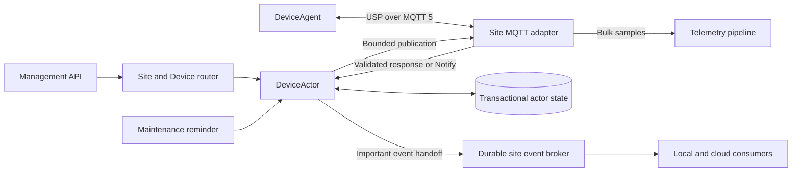

# Device actors, digital twins, commands, and events

Status: proposed architecture; phases 1 and 2 provide protocol extraction, Device
contracts and an opt-in actor state/twin implementation. Production registration,
command dispatch, protocol ingestion and deployment changes remain disabled.
Date: 2026-10-24.

## Decision and scope

Model each managed device as a Dapr `DeviceActor`. The actor owns its digital
twin, explicit command queue, response correlation, and important event outbox.
Dapr assigns actors to Controller hosts; hosts do not poll or compete to claim
commands from a shared SQL table. Actor state may use a shared transactional
backend, but that backend is not the work scheduler. Logical actor partitioning
does not itself physically shard storage.

Use Device terminology for new domain concepts: `DeviceActor`, `DeviceAgent`,
`DeviceIdentity`, and `DeviceTwin`. `DeviceAgent` means the remote USP Agent,
not another Dapr actor. Preserve standard USP Agent/Controller terminology,
protobuf names, existing `agent_id` wire fields, and provisioned endpoint IDs.
This proposal does not rename existing public fields or rewrite device IDs.

This is an alternative to the proposed [storage contracts](../storage-contracts.md)
and [SQL schema](../storage-schema.md), not an adapter implementing all of them.
It deliberately removes global command claims, command worker leases, scope-wide
submission identities, and Controller-owned per-destination delivery tracking.
It retains durable intent, bounded queues, protocol validation, and honest
uncertain outcomes. Exactly-once external execution is not a goal.

## Current implementation and reusable boundaries

| Source | Current behavior | Migration treatment |
|---|---|---|
| `internal/controller/controller.go` | Allocates message IDs, publishes directly, correlates responses through an in-memory map and channels; no application retry | Extract protocol validation/encoding; replace lifecycle with actor state |
| `internal/journal/journal.go` | Appends JSONL and syncs before allowing requested NotifyResp; capacity failure is sticky | Retain until actor inbox cutover; archive/import explicitly |
| `internal/mqtt/transport.go` | MQTT 5, per-Agent inbox mapping, nonpersistent sessions, bounded incoming channel with one receiver goroutine | Preserve identity validation and MQTT properties; introduce bounded concurrent actor routing |
| `internal/api/api.go` | Synchronous `POST /v1/requests`, server-generated identity, HTTP wait ends on response/timeout | Keep compatibility path; add durable asynchronous Device API |
| `cmd/usp-controller/main.go` | Wires Journal, transport, Controller and readiness together | Add explicit legacy/actor execution mode |
| `deploy/k3s/usp-controller.yaml` | Single replica, Recreate, local persistent volume | Keep unchanged until actor and transport topology gates pass |
| `internal/storage` | Proposed interfaces, not wired into runtime | Keep as historical alternative until a decision is accepted |

The existing Journal is not a transactional actor-state backend. Historical
requests cannot be reconstructed from the in-memory pending map after restart.
MQTT PUBACK can precede application processing today; only requested USP
NotifyResp supplies the application-level acceptance boundary.

## Identity, ownership, and topology

`DeviceIdentity = (tenant, logical Controller endpoint, DeviceAgent endpoint)`.
Encode the tuple unambiguously as a stable actor ID; never concatenate ambiguous
unescaped strings. Do not include pod or worker identity. Site inventory maps the
identity to its owning site before Dapr invocation. Actor placement is local to
that site's runtime. Site migration is an explicit quiesce, transfer, and route
change procedure, not ordinary actor failover.

All actor hosts register `DeviceActor` and use compatible state schemas. Disable
reentrancy initially. Never mutate actor state from background goroutines. Calls
are short turns, not device sessions or dedicated threads. Different devices
execute concurrently; one device serializes domain decisions.



First deploy one actor host with its existing MQTT adapter. Before multiple
hosts, select and test the transport topology separately: one controlled site
gateway or properly configured multiple MQTT connections/subscriptions. Dapr
placement does not configure broker identities, subscriptions, or revoke a
stalled publisher. Do not increase the existing replica count unchanged.

A remote gateway introduces a retriable RPC boundary: it must deduplicate stable
publish-attempt identities durably, or the product must explicitly accept duplicate
operations. The first prototype uses an in-process adapter to avoid this extra
boundary. Do not wrap explicit-operation publication in generic retry policies.

## Actor interfaces

The following Go-shaped interfaces describe domain contracts, not generated
Dapr handlers or a promise about a particular SDK signature. DTOs below are
specified in the following sections. SDK registration/serialization is an adapter.

```go
type DeviceActor interface {
    GetTwin(context.Context) (DeviceTwin, error)
    SetDesired(context.Context, SetDesiredRequest) (DesiredReceipt, error)
    EnqueueCommand(context.Context, CommandRequest) (CommandReceipt, error)
    GetCommand(context.Context, CommandID) (DeviceCommand, error)
    CancelCommand(context.Context, CancelCommandRequest) (DeviceCommand, error)
    HandleResponse(context.Context, ValidatedResponse) error
    HandleNotify(context.Context, ValidatedNotification) (NotifyReceipt, error)
    Tick(context.Context) error
}

type DeviceTransport interface {
    // No automatic application replay; bounded by the supplied context.
    Publish(context.Context, DeviceIdentity, PublishAttempt) (PublishResult, error)
}

type DeviceEventPublisher interface {
    // Success means configured durable broker acceptance, not consumer completion.
    Publish(context.Context, DeviceEvent) error
}
```

Actor identity is supplied by routing, not trusted from an arbitrary request body.
Authorize tenant/device access at the API and authenticate internal actor access.
Only the protocol adapter constructs validated inbound DTOs after checking sender,
recipient, inbox, response topic, version, header/body and payload bounds. Preserve
the current validation rules; actor routing is not authorization.

`SetDesiredRequest` contains stable request ID, expected desired revision and a
typed patch. `CommandRequest` contains stable request ID, canonical USP request,
absolute deadline and an operation class selected/validated by server policy.
The server chooses retry behavior; callers cannot mark an unsafe operation safe.
`CancelCommandRequest` contains command ID and expected command revision.
Receipts identify the device, request, revision and current status.

Identity is `(DeviceIdentity, requestID)` within a documented retention horizon.
Same identity and identical immutable content returns the existing result;
different content conflicts. Desired-update retries return the original receipt
even if the current desired revision subsequently advanced. Persist receipt and
desired update atomically. Command retries do not append or publish again.
This intentionally changes the earlier scope-wide command uniqueness contract.

## State model

Use separate actor keys with bounded indexes; activation must not load all history.

| Key | Fields and invariants |
|---|---|
| `meta` | Schema version, state revision, last contact, event epoch and next sequence |
| `desired` | Desired revision; typed managed values with policy/source |
| `reported` | Typed observed values, received/source time where available, freshness and provenance |
| `reconcile` | Target desired revision, pending differences, verification needed, next eligible time |
| `request/{id}` | Immutable submission fingerprint and original receipt for duplicate handling |
| `queue` | Bounded ordered command IDs, count and byte accounting |
| `command/{id}` | Request, message ID, optional operation key, state/revision, attempt ID, deadline, result and reason |
| `correlation/{messageID}` | Command or reconciliation attempt identity and expected response type |
| `operation/{operationKey}` | Asynchronous command identity; unique while retained within this actor |
| `notify/{id}` | Important Notify identity, canonical content fingerprint and acceptance receipt |
| `outbox` | Bounded ordered event IDs with byte accounting and retry eligibility |
| `event/{id}` | Immutable event payload, device identity, local sequence, timestamps and schema version |

Persist related changes in one actor-state transaction. Serialized turns alone
do not make multiple state saves atomic. After an ambiguous commit, reload durable
state before making another decision; do not continue from possibly stale memory.

`DeviceTwin` exposes desired/reported revisions, observed values, freshness,
last contact, convergence state, and pending/unknown operation summaries. A Set
response is evidence of acceptance/result, not automatically a fresh observed
value. Verify actual state through a read or notification. MQTT broker connectivity
does not imply device availability. Source clocks may be unreliable: local receipt
order must not be presented as device causal order.

Do not persist an unrestricted copy of every device parameter. Define managed
paths, sensitive-value handling, bounds, freshness rules, and read permissions.
Fleet queries use an eventually consistent projection; authoritative device reads
go through the actor. No cross-device transaction is offered.

## Commands and reconciliation

Configuration normally changes desired state. Offline updates coalesce to the
latest target. Reconciliation computes eligible differences, records the target
revision, sends bounded work, and verifies observed state. Results from an older
revision cannot mark a newer desired revision converged. Set/Add/Delete/Operate
are not automatically idempotent; operation-specific policy decides whether a
write can be repeated, verified first, or requires intervention.

Explicit operations use this lifecycle:

```text
queued -> attempting -> awaiting_response -> awaiting_completion
                    \-> unknown             \-> succeeded / failed
queued -> expired / cancelled
awaiting_response / awaiting_completion -> unknown on deadline
unknown -> resolved by validated later evidence or authorized reconciliation
```

Responses may settle a command directly without asynchronous completion. An
OperationComplete may precede OperateResp. Preserve evidence without regressing
a terminal outcome; contradictory evidence is surfaced for inspection.

Initially permit one explicit operation in flight per device. While awaiting a
response/completion, release the actor turn so notifications and reads can run.
After an unknown outcome, block conflicting mutating work until policy or an
operator resolves it; observational refreshes may continue. Avoid silently
executing a dependent command behind an uncertain operation.

`Tick` is bounded by a work count and elapsed-time budget:

1. Expire queued commands and evaluate outstanding deadlines.
2. Select eligible work fairly between explicit commands and reconciliation.
3. Atomically persist `attempting`, correlation, stable attempt/message IDs and
   dequeue the selected command.
4. Only the invocation that established the attempt calls transport once.
5. Persist acceptance or uncertainty. Never wait for a USP response in this turn.

A retried invocation observing `attempting` must not send again. On activation,
an interrupted explicit attempt becomes unknown. Even a crash before the actual
send can yield unknown: this is the accepted cost of avoiding automatic replay.
Admission should check transport availability before starting an attempt; a race
or ambiguous error after the boundary remains conservative.

QoS 1 PUBACK means broker acceptance, not execution. QoS 0 success only establishes
local send completion, so do not label it broker acknowledgment. Preserve MQTT
retransmission caveats. Application request timeouts and transport errors never
prove device failure or non-execution.

## Delivery policy and event flow

| Work | Default contract |
|---|---|
| Refresh/read | Bounded retries; obsolete queued refreshes may be replaced |
| Desired configuration | Persist latest intent; reconcile using operation-specific verification |
| Explicit side effect | Durable admission, one application publish attempt; ambiguity becomes unknown |
| Important Notify/event | Durable local acceptance; duplicate-tolerant broker handoff |
| Bulk telemetry | Bounded buffering, batching/coalescing or declared loss policy |

Default all USP notifications to important until a reviewed classifier explicitly
opts a category into lossy handling. Do not acknowledge a requested important
NotifyResp before durable acceptance. Notifications not requesting a response
retain the transport's possible-loss behavior; this design cannot make them
end-to-end reliable retroactively.

`HandleNotify` atomically deduplicates the canonical Notify, updates selected
reported fields, records optional operation completion, allocates an event ID and
appends an outbox entry. A conflicting payload under the same notification identity
is rejected. Duplicate receipt does not reapply twin changes or create another event.
Ingress sends NotifyResp only after the actor returns a durable receipt.

The actor publishes a small bounded batch from its outbox, then removes accepted
entries. Broker acceptance is the end of the Controller's delivery obligation;
consumer completion, per-destination retries and dead letters belong downstream.
If publish succeeds but removal fails, duplicate export is expected. Use stable
`(actorID, eventEpoch, sequence)` identities. Restoration must rotate the epoch
before generating new events while preserving IDs of retained events, so a rolled
back counter cannot collide with already exported events.

One ordered export stream per device is the starting point. Consumers tolerate
duplicates and gaps; configure broker partitioning by actor ID if ordered broker
consumption is required. Actor turn order is not a durable mailbox or source order.
The site MQTT ingress must use bounded concurrent dispatch so one slow actor does
not stall all devices, with a defined per-device ordering policy and backpressure.

Set count/byte limits for commands, inbox evidence and outbox data. Reject new
durable obligations when capacity is exhausted; important pending events are not
silently evicted. Reserve capacity for completion/control observations, and monitor
when admission stops. Prune completed records only after the documented dedup
horizon. Unknown operations require reconciliation or explicit audited disposition;
they are not deleted by an unconditional TTL.

## Wake-up, persistence, and offline behavior

Provision a stable recurring maintenance reminder for each managed device before
admitting its first durable work. Use staggered schedules and bounded turns.
Incoming calls may also process due work. Inventory reconciliation repairs missing
reminders. Registration failure prevents first admission; an orphan reminder with
no state is harmless. Reminder registration and state persistence are not one
transaction. Measure the cost before optimizing reminders to active devices only.

On recovery, reload pending work and classify interrupted attempts before dispatch.
Repeated reminder callbacks are safe because decisions use durable state. Scheduling
delays affect liveness, not permission to replay an explicit operation.

Keep required actor runtime services, actor state and the event handoff broker
available locally for autonomous sites. WAN loss delays cloud consumption. A
shared-state deployment must remain accessible after actor relocation; a pod-local
SQLite file is not a multi-host state service. Specify local-disk, node-loss and
site-loss guarantees separately. Dapr does not supply database/broker replication
simply by having multiple sidecars. Snapshot restoration requires controlled
retirement of old publishers and conservative treatment of potentially forgotten
attempts; restored queued work cannot blindly be replayed after a stale restore.

## Phased migration and gates

Each phase is independently reviewable. This document changes no runtime code.

| Phase | Work | Exit gate / rollback |
|---|---|---|
| 0: agree semantics | Approve Device naming, per-device submission identity, retry classes, queue limits, dedup horizon and failure model | Named decisions recorded; legacy runtime unchanged |
| 1: extract protocol boundary | Extract encoding, validation and classification from Controller; introduce Device DTOs and fake actor tests | Existing request/response, spoofing and persist-before-ack tests still pass; legacy remains default |
| 2: actor state and twin | Pin Dapr/Go SDK/component versions; implement state transactions, receipts, desired/reported twin and reminders | Duplicate/conflicting submissions, transaction failure, restart and reminder repair tests pass; shadow actors cannot send or acknowledge |
| 3: single-host command canary | Add asynchronous API and actor execution for an explicit device allowlist; preserve MQTT 5 adapter | No shared SQL claiming; crash-around-send and unknown-outcome tests pass; stop/drain canary before returning a device to legacy |
| 4: notifications and export | Switch selected devices to actor inbox/completion/outbox; provision durable broker; classify telemetry | Duplicate Notify, completion-before-response, broker outage, capacity and duplicate export tests pass; archive legacy Journal |
| 5: replica placement | Implement chosen MQTT ownership/subscription topology; shared actor state; readiness and rollout controls | Kill/rebalance and partition tests, no stale state writers, documented external-send limits; do not enable merely by raising replicas |
| 6: site rollout and twin reconciliation | Canary real devices; add managed-path policies, site routing, observability and fleet projections | Reconnect-storm, WAN outage, state/broker restore and node-failure drills meet declared budgets |

### API compatibility

Add a versioned Device API: desired patch with expected revision, command submit
returning 202 and a durable command handle, command status, queued-only cancel, and
twin read. Client disconnection does not cancel accepted work. Define durable
admission separately from transport readiness: offline devices can accept bounded
intent while execution is unavailable.

Keep `/v1/requests` behavior during migration. A compatibility adapter may submit
an internal identity and wait outside the actor, but legacy callers lacking a
stable key do not gain retry deduplication. Never silently turn HTTP 200 from a
USP response into an acceptance receipt. Preserve existing authentication and
`agent_id`; introduce renamed fields only through a versioned API.

### Cutover and rollback procedure

For each device cohort, stop new legacy mutations, drain requests up to a bounded
deadline, record unresolved outcomes in the cutover audit, and stop the old sender
before enabling actor dispatch. Never run both execution paths for the same device.
Seed reported state as stale and refresh; do not invent desired values from history.

Journal entries contain timestamp, Agent identity and Notify JSON, but no command
history or export receipts. Archive them intact. Optional import must be repeatable
and preserve source identities/times, mark records historical, and neither send
NotifyResp nor recreate device commands. Missing old command correlation is an
orphan historical event, not a successful new operation. Shadow reads/exports are
not a dual-write substitute for atomic acceptance.

Rollback after actor admission requires quiescing dispatch and export, snapshotting
actor state, draining or explicitly disposing of queued work, and reconciling
unknown operations. The legacy runtime cannot read actor queues: reverting a
binary alone would strand accepted work. Retain the actor executor/exporter until
its obligations finish, or use a reviewed migration tool. Never republish attempted
commands as part of rollback. Keep backward-readable schemas during rolling changes.

## Validation, observability, and open decisions

Required scenario tests: duplicate/conflicting request; desired revision race;
activation after admission; repeated Tick; kill before/after attempt commit and
MQTT publication; failed result commit; late response; completion before response;
duplicate Notify; event publish/removal gap; missing reminder; disk/backend full;
WAN loss; actor relocation; stale restore and old publisher retirement.

Measure actor turn latency, activation/state-commit latency, pending bytes and
oldest age, unknown operations, convergence lag, reminder delays, ingress pressure,
broker handoff failures, and consumer backlog. Aggregate metrics by site/policy;
avoid millions of device labels. Keep device identities in controlled logs/traces.
Use the busiest site and reconnect bursts, not only average fleet population.

Before production choose: state component and replication policy; broker and
retention; MQTT topology for multiple hosts; explicit-operation conflict policies;
managed twin paths; telemetry loss classes; reminder cadence; resource budgets;
dedup/retention windows; and site-transfer/restore procedures. Evaluate a simpler
single-host profile separately from a multi-host failure-survival profile.

## Official references

References support runtime capabilities, not a claim that the proposal is already
implemented. Pin versions and validate the Go SDK/component combination in phase 2.

- [Dapr Actors overview](https://docs.dapr.io/developing-applications/building-blocks/actors/actors-overview/): activation, placement and turn-based execution.
- [Actor API and state transactions](https://docs.dapr.io/reference/api/actors_api/): per-actor transactional state operations and reminders.
- [Scheduler](https://docs.dapr.io/concepts/dapr-services/scheduler/): reminder scheduling and separate persisted scheduling state.
- [State components](https://docs.dapr.io/reference/components-reference/supported-state-stores/): component-specific transactional and actor support.
- [Retry policies](https://docs.dapr.io/operations/resiliency/policies/retries/retries-overview/): runtime and component retries must be considered together.
- [Pub/sub](https://docs.dapr.io/developing-applications/building-blocks/pubsub/pubsub-overview/): duplicate-tolerant event transport, subject to broker configuration.

## Phase 1 implementation boundary

`internal/protocol` now owns request type derivation, Record encoding, inbound
Record/message validation, and wire-profile constants. The legacy Controller
retains request correlation, timeout handling, journal persistence and NotifyResp
publication. Existing exported Controller helpers delegate for compatibility.
HTTP and MQTT adapters use protocol rules directly.

`internal/device` defines the Device actor DTOs and interfaces without a Dapr
dependency or an actor implementation. Its synchronous `DeviceRequester` contract
is used by the existing HTTP adapter and implemented by the legacy Controller.
Inbound Device DTOs require trusted ingress validation; their Go type alone is
not an authentication guarantee. No durable admission or retries are enabled.

Phase 2 must implement actor behavior and fake actor lifecycle tests; phase 1
uses existing legacy integration tests plus direct protocol boundary tests.

## Phase 2 implementation and validation scope

`internal/deviceactor` implements `device.DeviceActor` as a dormant state owner.
The production `cmd/usp-controller` wiring, configuration, API and manifests are
unchanged. There is no transport or event publisher dependency in this actor, no
Dapr SDK dependency, and no automatic command dispatch. `Tick` only expires queued
commands; `HandleResponse` and `HandleNotify` return `ErrDisabled`, so callers
cannot mistake this prototype for a durable notification acknowledgment path.

Implemented behavior:

- Desired patches with revision checks, removals and persistent original receipts.
- Trusted reported observations with identity checks, per-parameter receipt times,
  stale-observation suppression and freshness-aware convergence on reads.
- Per-device request IDs shared across mutation kinds; conflicting reuse fails.
- Queued command admission, canonical protobuf storage, duplicate submission,
  queued-only cancellation and deadline expiry. No operation is sent.
- Reminder provisioning before admission, repair during activation and retries,
  deterministic initial staggering, and idempotent maintenance callbacks.
- No mutable state cache: every operation reloads committed data, including after
  an ambiguous write response. Returned maps and protobufs are detached.

### Deliberate bounded prototype representation

Phase 2 uses one versioned `snapshot-v1` actor key, atomically containing twin,
receipts, queue and command records. This replaces the proposed multi-key layout
for the prototype only: defaults are 1 MiB serialized state, 1,024 receipts,
64 retained commands, and 1,024 desired/reported parameters each. The snapshot is
reloaded on every turn. There is no receipt or command pruning yet; exhaustion
rejects admission rather than evicting deduplication identities. Cancelled/expired
commands still count toward retention capacity. A backend-specific safe item size
must be configured before any deployed pilot.

Before phase 3/production, benchmark write amplification and migrate to the
proposed indexed multi-key layout if required. Any such migration must preserve
atomic twin/receipt writes and command identities. Do not feed high-volume
telemetry into this bounded receipt store. `Report` is a trusted adapter method,
not a public endpoint or a replacement for the later atomic Notify inbox/outbox.
ReceivedAt comes from validated ingress; source ordering and data-model validation
remain adapter responsibilities. No desired-state write is executed.

### Dapr adapter and private callback handler

`NewDaprBackend` targets the documented Dapr **1.19 HTTP actor API**, including
reminder listing. Pin and qualify 1.19.x and the chosen transactional actor-state
component before a live deployment. An older sidecar without reminder listing
fails admission rather than guessing that a reminder is missing. No Go SDK is
required. State is saved with a single actor-state transaction, without TTL.
Scheduler errors block new admission; an existing reminder is inspected rather
than recreated on every update. Period/TTL mismatch fails closed for explicit
operator repair. HTTP calls have bounded timeouts and do not automatically retry.

`NewHost` exposes a private, app-token-authenticated callback handler for a fixed
provisioned actor set. It supports Dapr configuration/deactivation, GetTwin,
SetDesired, Report, explicit Activate and the maintenance reminder callback.
Reentrancy is disabled. Command and USP notification HTTP methods are deliberately
not exposed. Objects contain only dependencies and local locks; no durable state
is cached, including across activation IDs. Inventory bounds local object count.
A deployment must let Dapr serialize actor calls across hosts: the local mutex is
not a distributed lock. Never call the backend from an independent worker.

An embedding test host supplies each actor's identity, backend and options, then
mounts `NewHost` on a private listener whose token matches Dapr's app API token.
The Dapr API token passed to `NewDaprBackend` is a separate credential. Neither
handler nor listener is installed by the production main. Inventory maintenance
must periodically invoke Activate to repair missing reminders for inactive actors;
that fleet loop is not yet wired into production.

### Tests and remaining rollout gates

Unit and HTTP contract tests cover reactivation, original receipt replay after
later revisions, conflicting payloads, stale revisions, concurrent local turns,
reminder failure/repair, failed and ambiguous commit, cross-device isolation,
corrupt/schema-mismatched state, freshness, out-of-order reports, detached values,
queue expiry/cancellation, capacity, callback authentication and disabled methods.
A fake Dapr HTTP server verifies paths, transaction shape, API token, reminder
staggering, no reminder reset on retry and read-back after a lost commit response.

These tests do not prove live Dapr placement, Scheduler availability, component
replication or failover. A Dapr binary is not installed in the development
environment used for this phase; a live pinned-runtime/component smoke test is
still required before mounting the host in a pilot. Legacy regression tests remain
the gate for the unchanged production default.
